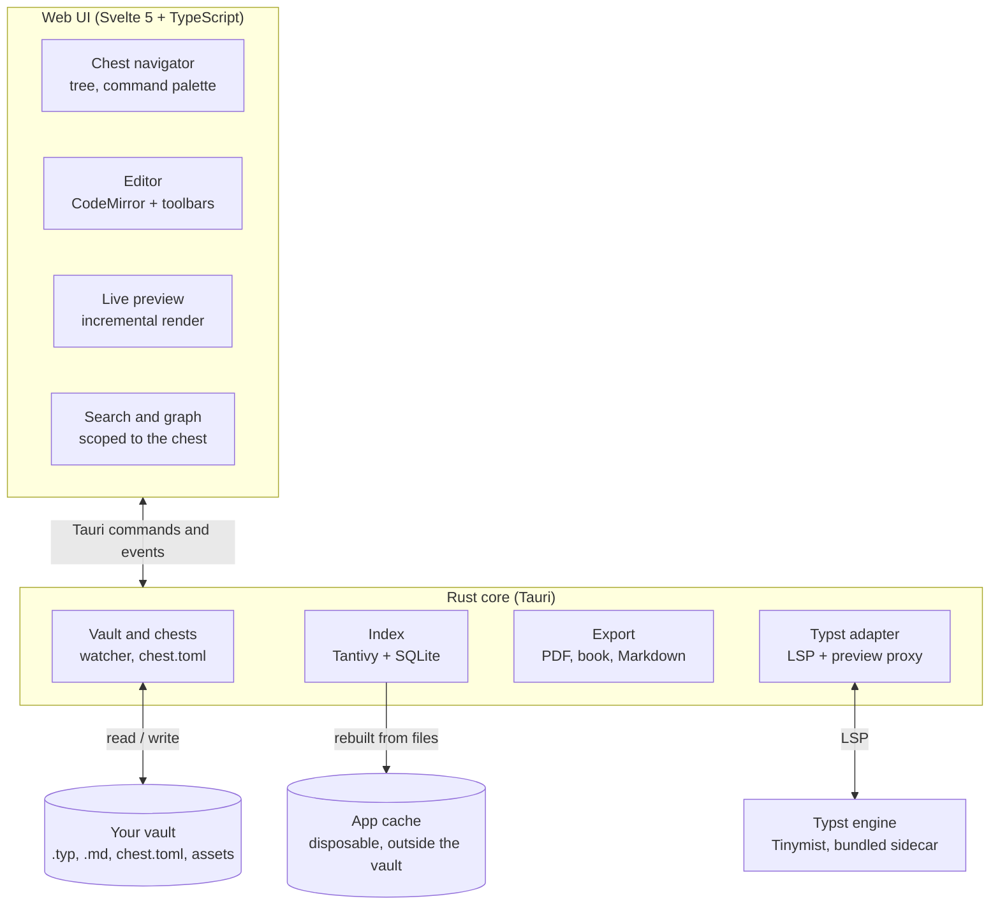
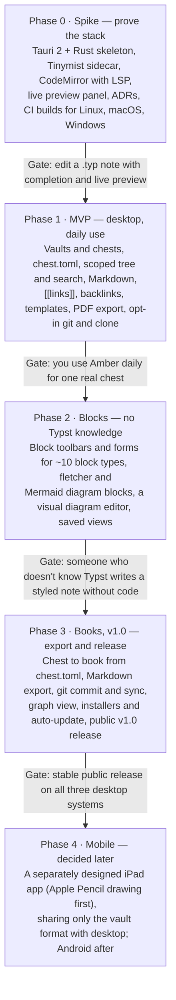

# Amber — Plan & Roadmap

Nov 14, 2026 · Arsham Arya · Live version: https://claude.ai/artifact/N7NieyqyNKqSQGqcmhFBaH

## Vision

Amber is a local-first, open-source notes app where every note is a plain `.typ` or `.md` file, and every project lives in its own isolated **chest**. Recommendation: build it on Tauri 2 + Rust with Tinymist on desktop first, ship an MVP with chests, Typst editing, live preview and PDF export, then add books, diagrams and mobile.

**Promise:** your notes belong to you. Notes are plain text files in folders you choose. Config is readable TOML. The search index and caches are disposable and live outside the vault. Delete Amber and you lose nothing.

**Where Amber beats Obsidian:**

- **Chests.** A vault holds many chests. Opening a chest scopes the file tree, search, links, graph and tags to that chest. One vault per device is enough; chests give the per-project isolation.
- **Typst.** Real typesetting for maths, layout and figures. Notes stay readable as text, PDF export is first-class, and Markdown export trims notes down to a portable subset.
- **Diagrams.** Typst packages such as [fletcher](https://typst.app/universe/package/fletcher) and CeTZ draw flowcharts, state machines and commutative diagrams. The [merman](https://typst.app/universe/package/merman) package renders Mermaid inside Typst, so Mermaid stays possible too.
- **Books.** A whole chest exports as a book, with folders mapped to chapters in its config.
- **No Typst knowledge needed.** Block toolbars and forms write the Typst for the user.

**Out of scope:** several formats inside one file. **Parked for later** (listed in the Roadmap): real-time collaboration, a hosted sync service, AI features, Markdown-in-Typst embedding, and links between chests.

## Core concepts

There are three levels: **vault → chest → note**. All three are plain folders and files; the app only adds scoping and config.

| Concept | On disk | In the app |
| --- | --- | --- |
| Vault | A root folder with `amber.toml`; git is an opt-in checkbox at creation, or the vault is cloned from a remote | Usually one per person; a second only for private or someone else's notes |
| Chest | A first-level folder with `chest.toml` | Opening it scopes tree, search, links, tags and graph to that chest |
| Note | A `.typ` or `.md` file anywhere inside a chest | One format per file, chosen at creation, convertible later |
| Attachment | Images, PDFs, drawings inside the chest | Embedded by relative path |

Example layout:

```
MyVault/
  amber.toml                # vault settings that should follow the vault
  _shared/                  # optional: templates and Typst styles all chests can use
  thesis/
    chest.toml
    01-intro/  02-method/
    assets/
  german-a1/
    chest.toml
    ...
```

**Config format: TOML, not YAML.** Each vault gets `amber.toml` and each chest gets `chest.toml`. Typst packages already use `typst.toml`, and Typst's `toml()` function lets a book template read `chest.toml` directly. TOML has no indentation traps and no surprise type coercion (YAML reads `no` as false). Rust's `toml_edit` crate changes one setting without wiping the user's comments. The cost: nested data, such as view filters, is wordier than in YAML. Markdown notes keep YAML frontmatter, because that is the standard there. From Tolaria we keep config as readable files that travel with the vault, saved views as filter trees, and a `_` prefix for hidden system fields.

Draft `chest.toml`:

```toml
name = "Thesis"
icon = "book"
color = "amber"
default_format = "typst"        # "typst" | "markdown"
template = "_shared/note.typ"   # style applied to new notes

[[views]]
name = "Drafts"
filter = { all = [{ field = "status", op = "equals", value = "draft" }] }

[book]
title = "Quantum Error Correction"
author = "Arsham Arya"
output = "build/thesis.pdf"

[[book.chapters]]
folder = "01-intro"
title = "Introduction"

[[book.chapters]]
folder = "02-method"
title = "Method"
```

Chests are strictly isolated in v1: wiki links (`[[Note]]`) resolve only inside the current chest. An opt-in `cross_chest = true` setting is parked for later.

**Metadata in Typst notes.** Markdown notes keep YAML frontmatter. Typst notes have no frontmatter, so Amber reads a leading comment block or a `#metadata((...)) <amber>` call. The second option is valid Typst and can be queried by the compiler.

**One format per file.** Mixing formats inside one file means two parsers, two cursor models and broken round-trips, so Amber won't do it. Embedding is a cheap alternative: a Typst note can include a Markdown file through a Markdown-in-Typst package such as cmarker (parked for later).

## Technology recommendation

Use **Tauri 2 with a Rust core and a Svelte 5 + TypeScript UI** for the desktop app. Typst and Tinymist are Rust, so a Rust core can drive them directly. One codebase serves Linux, macOS and Windows. Mobile gets its own decision later, so nothing here is shaped around it.

| Layer | Recommendation | Why | Alternatives considered |
| --- | --- | --- | --- |
| App shell | Tauri 2 (desktop) | Small binaries, Rust backend, one codebase for Linux, macOS, Windows | Electron (heavier, still needs a Tinymist process) |
| Core | Rust: file watcher, chest scoping, link index, export, git | Same language as Typst and Tinymist; fast indexing | Logic in the webview (slower indexing, no native git) |
| UI | TypeScript + Svelte 5 | Stable, signal-based runes, larger ecosystem, simple templates | SolidJS (compared below) |
| Editor | CodeMirror 6 with an LSP bridge to Tinymist | Proven for Typst; inline widgets carry the block toolbars | Tiptap/ProseMirror true WYSIWYG (very hard to round-trip to Typst) |
| Typst engine | [Tinymist](https://github.com/Myriad-Dreamin/tinymist) as a bundled sidecar: `tinymist lsp` for completion, diagnostics and formatting | Off-the-shelf, battle-tested in VS Code, Neovim and Obsidian plugins | Embedding its crates in-process (APIs not stable) |
| Live preview | Tinymist's incremental preview, shown in a webview panel with source↔preview jump | Already streams incremental updates | Our own renderer with [typst.ts](https://myriad-dreamin.github.io/typst.ts/) |
| Markdown | CodeMirror Markdown mode + comrak (Rust) for rendering | Fast, CommonMark/GFM | markdown-it |
| Search | Tantivy full-text + a SQLite link/tag index, both in the app cache dir | Rebuildable from files; nothing hidden in the vault | Plain grep (too slow past a few thousand notes) |
| Diagrams | fletcher + CeTZ, merman for Mermaid, a visual node editor that writes fletcher code | Native to Typst, exports in PDF | Excalidraw-style JSON (not Typst) |
| Export | Typst → PDF (native); chest → book from `chest.toml`; Typst → Markdown through our own converter on the Typst syntax tree | Controlled trimming to a Markdown subset | Pandoc (extra dependency, less control) |
| Config | TOML (`amber.toml`, `chest.toml`), edited with `toml_edit` | Typst reads it natively; user comments survive app edits | YAML (Tolaria's choice), JSON |
| Git | git2 or system git, opt-in per vault; clone a vault when creating it | Optional, as decided | Required per vault (Tolaria) |
| Mobile | Decided later, designed separately | Desktop and iPad don't limit each other | Tauri mobile with the shared UI |

**Svelte 5 vs SolidJS.** Both use fine-grained signals with no virtual DOM, and both work with CodeMirror and Tauri. The real difference is maturity.

| | Svelte 5 | SolidJS |
| --- | --- | --- |
| Status (Nov 2026) | Stable; [5.57.2 released Oct 2026](https://releases.sh/svelte/svelte-releases.md) | [2.0 is a release candidate](https://socket.dev/npm/package/solid-js/overview/2.0.0-rc.2); 1.x is stable |
| Breaking changes ahead | None expected within 5.x | [2.0 renames and removes 1.x APIs](https://www.infoq.com/news/2026/05/solidjs-2-async/) |
| Syntax | `.svelte` templates + runes (`$state`, `$derived`) | Plain TSX; components run once |
| Raw speed | Very fast | Slightly faster in benchmarks |
| Ecosystem | Larger: UI kits, Tauri templates, more answers online | Smaller; one main maintainer |
| Typst precedent | — | InkyCap Notes uses Tauri + Solid |

Recommendation: **Svelte 5**. For an editor-heavy app, the speed gap won't show, but starting on Solid now means choosing between 1.x and migrating soon, or building on an RC. Revisit once Solid 2.0 is stable if you prefer JSX.

## Architecture overview

Files stay the source of truth; everything else is rebuildable.



The UI never touches files directly; it asks the Rust core. Only the vault is precious. The index and cache can be deleted and rebuilt, and the Typst engine sits behind one adapter, so a later mobile app can swap it out.

## Roadmap

Five phases: desktop daily use first, mobile last.



**Progress:** Phase 0 done (v0.0.1). Phase 1 built and in daily-use testing; see ADRs 0004 and 0005 for its decisions.

The phases have no dates on purpose. Pass each gate before starting the next phase. Phase 1 is the one that matters most: if you don't use Amber daily for real notes, nothing after it is worth building yet.

**Parked for later.** These are not in any phase yet. Each needs its own decision before it gets one:

- **Real-time collaboration:** several people editing one note at once (CRDT-based, such as Yjs or Automerge).
- **Hosted sync service:** an optional paid sync and backup server. This is also the self-hosting income path.
- **AI features:** asking questions over a chest, writing help, an agent-friendly file layout like Tolaria's AGENTS file.
- **Markdown-in-Typst:** embedding a `.md` file inside a Typst note through a package such as cmarker.
- **Links between chests:** an opt-in `cross_chest` setting in `chest.toml`.

## Decisions

All decisions below are made.

- [x] **UI framework:** Svelte 5 (stable, larger ecosystem) over SolidJS (2.0 still a release candidate). See the comparison under Technology and ADR 0002.
- [x] **Editing model:** source editor + live preview + block toolbars (realistic for v1).
- [x] **Link syntax in Typst notes:** `[[Note]]` text styled by an Amber Typst package through a show rule (same as Obsidian, looks fine in PDF).
- [x] **Chest isolation:** strict for now; cross-chest can become an option in the future.
- [x] **Git:** when creating a new vault, the user decides (an optional checkbox). Some vaults can be cloned in the first place using the app.
- [x] **Mobile:** decide for iPad later. It should not affect the desktop version, and desktop limitations should not carry into the iPad app.
- [x] **License:** open source, with the option to make money from self-hosting later.
- [x] **Name and repo:** Amber, under `arshamalh` on GitHub.

**What these decisions change:**

- **Editing model and links:** Phase 1 ships a source editor with live preview; block toolbars come in Phase 2. The Amber Typst package styles `[[Note]]` through a show rule.
- **Chests:** strict isolation in v1; cross-chest links are parked.
- **Git:** a checkbox when creating a vault, plus "clone a vault" from a remote, both in Phase 1.
- **Mobile:** removed from the desktop design. Phase 4 is a separate decision, so neither platform inherits the other's limits.
- **License:** suggested **AGPL-3.0**. The code stays open source, and anyone who runs a modified Amber as a hosted service must publish their changes, which protects a paid self-hosting or sync offer. As the copyright holder, Arsham can still run his own hosted service. To sell other licenses later, ask contributors to sign a CLA. AGPL-3.0 also matches Tolaria, so its code could be reused with attribution. Tinymist's Apache-2.0 license is compatible. (Not legal advice; check before publishing.)
- **Name and repo:** Amber, under `arshamalh` on GitHub.

## Risks and lessons from Tolaria

The biggest risk is the "no Typst knowledge needed" promise. Plan for it from the first milestone instead of adding it at the end.

| Risk | Impact | Mitigation |
| --- | --- | --- |
| Block toolbars that hide Typst are hard to build well | Core promise slips | Start with ~10 block types (heading, list, table, image, maths, callout, diagram, code, link, page break), each a form that writes plain Typst |
| Tinymist APIs and preview protocol change between releases | Breakage on upgrade | Pin a Tinymist version per Amber release; talk to it only over LSP + the preview protocol |
| Typst compile time on large books | Slow preview | Preview one note at a time; compile books only on export |
| `[[Note]]` show rule clashes with users' own Typst | Odd rendering in some notes | Keep the Amber package small and documented; allow turning the rule off per note |
| A mobile app later can't run the Tinymist binary | Mobile needs another Typst path | Keep compile/preview behind one adapter now; decide the mobile path in Phase 4 |
| Solo maintainer scope | Burnout, stalled releases | Ship the MVP on desktop only; keep parked items parked |

**What to take from Tolaria:**

- **Files are the source of truth, the cache lives outside the vault** (their ADR 0002 and 0024). This matches our promise exactly.
- **The vault vs app settings rule** (ADR 0004): if a setting should follow the vault to another device, it goes in the vault; window size and API keys go in app settings.
- **Saved views as filter trees** (ADR 0040: `all`/`any` groups with `equals`, `contains`, `before`…). We reuse the filter tree inside `chest.toml`.
- **ADRs from day one.** Tolaria has 298 of them; a short `docs/adr/` keeps decisions out of chat history.

**What to do differently:**

- Tolaria went to a **flat vault** with types in frontmatter (ADR 0006). That is the opposite of chests. Folders stay meaningful in Amber.
- Its sidebar is always open. Amber's chest picker and file tree should collapse into a command palette.
- Tolaria planned the iPad on Tauri iOS (ADR 0005, with a re-evaluation trigger) but now ships a separate Expo/React Native app. That's a warning that Tauri mobile may not be enough.
- **License:** Tolaria is **AGPL-3.0**. Copying its code makes Amber AGPL too, which fits the AGPL-3.0 suggestion above.

## Sources

- [Tinymist](https://github.com/Myriad-Dreamin/tinymist): Typst language server and preview
- [typst.ts](https://myriad-dreamin.github.io/typst.ts/): Typst compiler and renderer in WASM
- [fletcher](https://typst.app/universe/package/fletcher) and [merman](https://typst.app/universe/package/merman): Typst diagram packages
- [InkyCap Notes](https://codeberg.org/NSBuitrago/app): an existing Typst PKM app, for comparison
- [Svelte releases](https://releases.sh/svelte/svelte-releases.md), [SolidJS 2.0 RC](https://socket.dev/npm/package/solid-js/overview/2.0.0-rc.2), [InfoQ on SolidJS 2.0](https://www.infoq.com/news/2026/05/solidjs-2-async/)
- Tolaria repo (local clone): README, `docs/adr/` 0002, 0004, 0005, 0006, 0024, 0040, LICENSE
